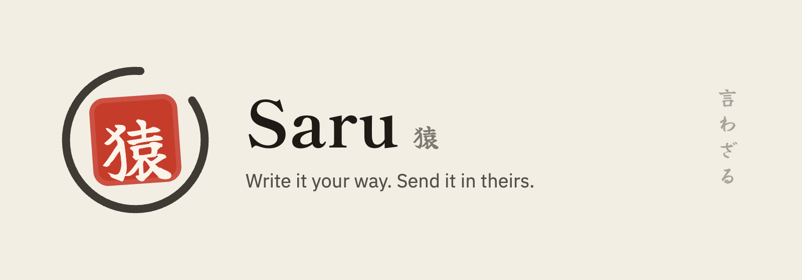
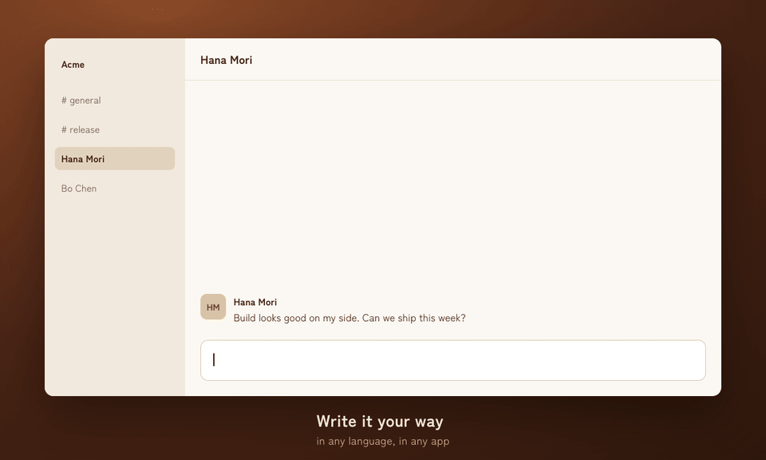
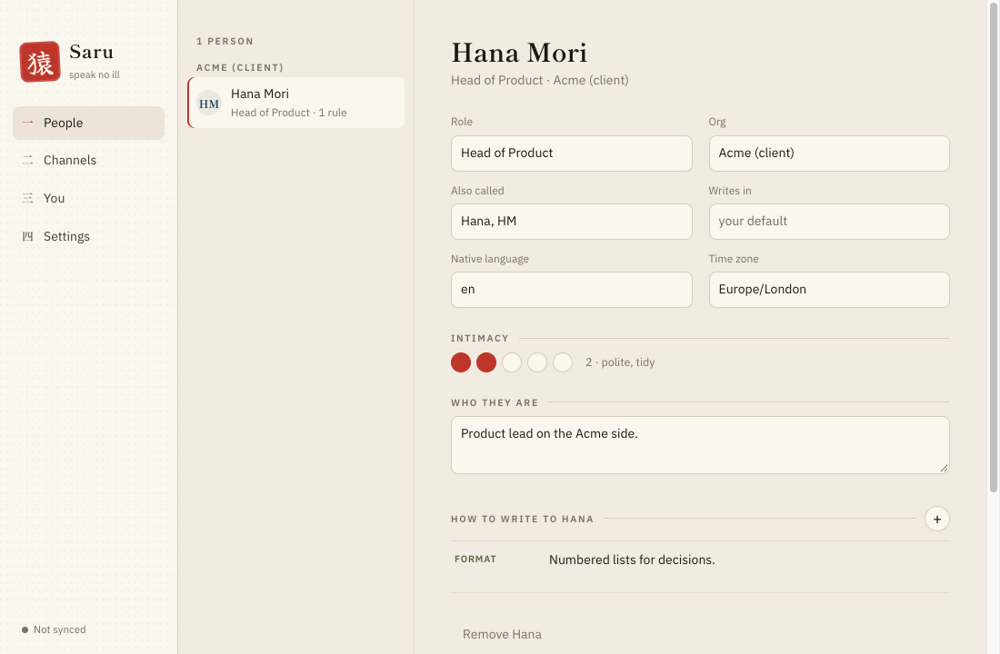
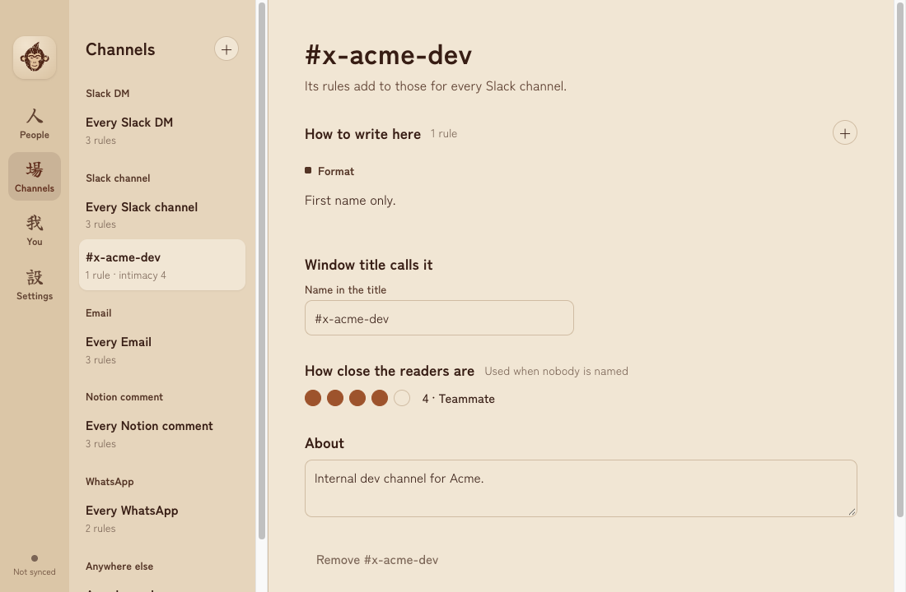

<p align="center">
  
</p>

<p align="center">
  <a href="https://github.com/AlvaroYmagawa/saru/actions/workflows/ci.yml"></a>
  <a href="https://github.com/AlvaroYmagawa/saru/releases"></a>
  
  
  <a href="LICENSE"></a>
</p>

<p align="center">
  <b>A menu-bar app that rewrites the message you're typing so it reads the way a native speaker
  would write it, to that person, in that place.</b><br>
  Write in any language, press <kbd>⌥</kbd><kbd>⌘</kbd><kbd>P</kbd>, approve, paste.
</p>

<p align="center">
  <a href="#install">Install</a> ·
  <a href="#first-run">First run</a> ·
  <a href="#how-it-works">How it works</a> ·
  <a href="#use-it-from-claude-code">Claude Code plugin</a> ·
  <a href="#privacy-and-security">Privacy</a>
</p>

<p align="center">
  
</p>

## What it does

- **Rewrites in your voice.** Draft in Portuguese, Spanish or broken English; Saru writes it the
  way you would if the language were native, in the variant you choose (British English by default).
- **Knows who's reading.** Each person has a role, an intimacy level (1 cold contact … 5 close
  friend), the language they read and their own rules ("numbered lists for decisions").
- **Knows where it's going.** A Slack DM isn't `#general`, and neither is an email or a Notion
  comment. Each kind of place has its rules, and a named channel adds its own.
- **Learns you on day one.** With no profile yet, Saru reads your own recent Slack messages
  (read-only) and writes down how you sound.
- **Everything by a sentence.** Press **+** and say a rule ("she hates emoji, sign off with just K");
  tell Saru "Ana is our CFO now". Saru turns it into structured notes you can edit or undo.
- **New people in one step.** Writing to someone Saru doesn't know? The panel offers to add them
  and rewrites the draft with what you said.
- **You approve every word.** Nothing is sent. Saru pastes into your draft only when you press
  <kbd>⌘</kbd><kbd>↵</kbd>; a plain Enter never pastes.
- **Your notes stay yours.** Plain JSON on your Mac, optionally synced to a **private** GitHub repo.

<p align="center">
  <picture>
    <source media="(prefers-color-scheme: dark)" srcset="docs/art/people-dark.png">
    
  </picture>
  <picture>
    <source media="(prefers-color-scheme: dark)" srcset="docs/art/channels-dark.png">
    
  </picture>
</p>

## Install

**Requirements**

- macOS 13 or later (Apple silicon or Intel).
- [Claude Code](https://code.claude.com/docs/en/setup), installed and signed in: `claude` works in
  your terminal. Saru runs it on your own Claude plan or API key and never sees your login.
- Optional, to sync your notes: git (`xcode-select --install`) and a GitHub account.
- Optional, to learn your style: Slack connected to Claude Code (the Slack plugin or connector).

### Download (recommended)

1. Get the latest `.dmg` from [Releases](https://github.com/AlvaroYmagawa/saru/releases):
   `Saru-<version>-arm64.dmg` for Apple silicon, `Saru-<version>-x64.dmg` for Intel.
2. Open it and drag **Saru** to **Applications**.
3. Saru isn't notarised by Apple yet, so the first time **right-click Saru → Open → Open**.
   If macOS says the app is damaged, run this once and open it again:

   ```sh
   xattr -dr com.apple.quarantine /Applications/Saru.app
   ```

### Build from source

```sh
git clone https://github.com/AlvaroYmagawa/saru.git
cd saru
bun install          # npm install works too
bun run dist         # → release/Saru-<version>-<arch>.dmg
```

`bun run dev` runs it straight from the source. To sign your own build with a certificate from your
keychain, so macOS keeps Saru's permissions across rebuilds, set `CSC_NAME="<certificate name>"`
before `bun run dist`.

## First run

1. Saru lives in the menu bar: look for the monkey's head.
2. macOS asks to let Saru use **Accessibility** and control **System Events**. Allow both in
   System Settings → Privacy & Security; Saru needs them to copy your draft and paste the new one.
   An unsigned build gets a new identity on every update, so you may have to allow it again.
3. Saru opens **You**. If Slack is connected to Claude Code, it learns your style from your own
   messages: it can only search and read, and every tool that sends, drafts, reacts or edits is
   denied. No Slack? Tell Saru about yourself in a sentence, or fill in the page.
4. Write a message anywhere and press <kbd>⌥</kbd><kbd>⌘</kbd><kbd>P</kbd>.

## How it works

<p align="center">
  <picture>
    <source media="(prefers-color-scheme: dark)" srcset="docs/art/panel-dark.png">
    
  </picture>
</p>

1. **Read.** Saru copies the text box (and puts your clipboard back) and reads the window title,
   `Hana Mori (DM) - Acme - Slack`, to work out who it's for and where it's going: Slack DM, Slack
   channel, email, Notion comment, WhatsApp, or anywhere else.
2. **Gather.** It collects your voice, that person's rules and the place's rules.
3. **Write.** Your own `claude -p` rewrites the draft, with no tools and none of your settings,
   so it can only answer.
4. **Approve.** The panel shows your draft and Saru's version.

| Key | In the panel |
| --- | --- |
| <kbd>⌘</kbd><kbd>↵</kbd> or **Paste** | paste Saru's version over your draft |
| type, then <kbd>↵</kbd> | ask for a change ("shorter", "warmer"); the whole message is rewritten |
| <kbd>esc</kbd> | close; your draft is untouched |

@mentions stay exactly as you wrote them; if one goes missing, the panel says so before you paste.

### Your notes

| Window | What's there |
| --- | --- |
| **People** | everyone you write to, by organisation: role, intimacy, language, rules |
| **Channels** | rules for every Slack DM, Slack channel, email, Notion comment, WhatsApp, and named places |
| **You** | your voice: languages, a description, rules for every message, *Learn from Slack* |
| **Settings** | shortcut, light or dark theme, Claude model, `claude` path, data repo |

Press **+** to add a rule in a sentence, click a rule to edit it, and right-click anything to
delete it (Saru asks first, and you can undo).

## Keep your notes in a private repo

Your notes are plain JSON files in `~/.local/share/saru`. To back them up and share them between
Macs, point Saru at a **private** GitHub repo:

```sh
gh repo create saru-data --private
```

Then **Settings → Your notes → Private repo**: `you/saru-data`. Saru turns the folder into a clone
of that repo and commits and pushes each change a few seconds later, with your own git login (the
macOS keychain or `gh auth setup-git`). On a second Mac, set the same repo and Saru pulls your
notes; anything already in the folder is copied aside first. Saru refuses a public repo.

## Use it from Claude Code

The repo is also a Claude Code plugin, so messages Claude writes for you in a session follow the
same notes:

```text
/plugin marketplace add AlvaroYmagawa/saru
/plugin install saru@saru
```

"Reply to Hana on Slack: …" is polished with Hana's and the channel's rules, and "add a rule for
Hana: numbered lists for decisions" saves it to Saru.

**The send guard.** The plugin also stops Claude from sending a message Saru didn't write. Any Slack
message, Notion comment or Gmail email that a tool is about to send is checked: unless its text
went through `saru:polish` in the last 24 hours, the send is refused and Claude is told to polish it
first and show you. To send your own words unchanged, ask for it: Claude marks them as yours with
`saru mark`. `SARU_GUARD=off` turns the guard off.

## Settings file

`~/.config/saru/config.json` (or `$SARU_CONFIG`). The app writes it; every field is optional.

| Field | Default | What |
| --- | --- | --- |
| `shortcut` | `Alt+Command+P` | the shortcut, as an Electron accelerator |
| `theme` | `system` | `system`, `light` or `dark` |
| `model` | `sonnet` | `claude --model` |
| `claudePath` | from your shell | absolute path to `claude` |
| `timeoutSeconds` | `90` | give up on a draft or a rule after this |
| `keystrokeDelayMs` | `180` | how long the other app gets to copy or paste |
| `dataDir` | `~/.local/share/saru` | where your notes live (`$SARU_DATA_DIR` wins) |
| `dataRepo` | none | private repo to sync to, as `owner/name` |
| `syncDelaySeconds` | `20` | wait after a change before pushing |

## Privacy and security

- Your draft, and the notes needed to rewrite it, go to Anthropic through **your own Claude Code**,
  on your own account. Nothing goes anywhere else: Saru has no server and no telemetry.
- When writing, Claude runs with **no tools** and none of your Claude Code settings, plugins or MCP
  servers. Your draft is treated as text to rewrite, never as instructions.
- When learning your style, Claude may only **search and read** Slack; sending, drafting, reacting
  and editing are denied, and anything not explicitly allowed is refused.
- Every answer is checked against a schema before Saru saves or pastes anything.
- Sync uses your git credentials; Saru never stores a token, and refuses a public repo.

See [SECURITY.md](SECURITY.md) to report a problem.

## Troubleshooting

| Problem | Fix |
| --- | --- |
| The panel says it needs Accessibility | System Settings → Privacy & Security → Accessibility → turn on Saru, then press the shortcut again |
| "Couldn't find the claude command" | install Claude Code, or set its path in Settings |
| "⌥⌘P is already used by another app" | pick another shortcut in Settings |
| "Saru is damaged and can't be opened" | `xattr -dr com.apple.quarantine /Applications/Saru.app` |
| Sync failed | check you can `git push` to the repo from a terminal; Saru retries every minute |
| "Couldn't learn from Slack" | connect Slack to Claude Code, or tell Saru about yourself on the You page |

## Develop

```sh
bun install
bun run check        # types + unit tests
bun run e2e          # the app end to end, with a stand-in for claude (e2e/fixtures)
bun run dev          # run it
bun run art          # re-render the icon, menu-bar glyph and banners from resources/monkey.svg
bun run demo         # re-render docs/art/demo.gif (needs ffmpeg)
bun run saru -- help # the command line: context, migrate, add-rule, tell, sync
```

| Path | What |
| --- | --- |
| `src/core` | notes, channels, Claude calls, profile learning, sync, import (no Electron) |
| `src/main` | menu bar, shortcut, panel, copy and paste through System Events |
| `src/renderer` | the panel and the People / Channels / You / Settings window |
| `src/cli` | `saru`, also bundled into the plugin as `plugin/scripts/saru.cjs` |
| `plugin` | the Claude Code plugin, and `rules.md`: how Saru writes |
| `resources/monkey.svg` | the mark; the icon, menu-bar glyph, banners and app all use it |

Contributions are welcome: read [CONTRIBUTING.md](CONTRIBUTING.md) first.

## Why a monkey

Saru (猿) is Japanese for monkey, and *-zaru* is also an old ending meaning "not". Over a stable
door at the Tōshōgū shrine in Nikkō, three monkeys cover their eyes, ears and mouth: *mizaru,
kikazaru, iwazaru* (見ざる 聞かざる 言わざる), see no ill, hear no ill, speak no ill. Saru is the
third one, who minds his words: what leaves your keyboard says what you meant, the way the reader
takes it well, and nothing you'd regret.

---

<p align="center">
  <br>
  <sub>MIT licence · fonts: Zen Kaku Gothic New and Yuji Syuku (SIL Open Font License)</sub>
</p>
