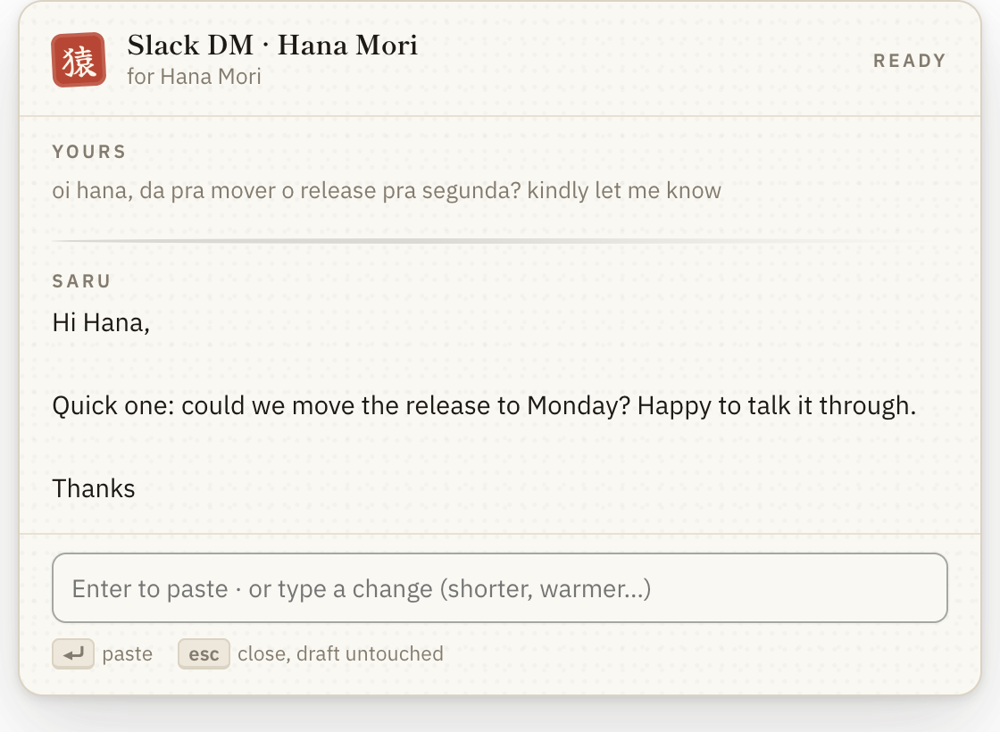

<p align="center">
  <picture>
    <source media="(prefers-color-scheme: dark)" srcset="docs/art/banner-dark.png">
    
  </picture>
</p>

<p align="center"><i>
  Write your message in any language, press <b>⌥⌘P</b>, and send it the way a native speaker would:<br>
  tuned to the person you're writing to and the place you're writing in. You approve every word.
</i></p>

## 一 · What it is

Saru (猿, *monkey*) is a macOS menu-bar app. In Slack, Mail, Gmail, WhatsApp or any text box,
write your draft and press the shortcut:

1. Saru copies the box, reads the window's title (`Hana Mori (DM) - Acme - Slack`) to work out
   **who** it's for and **where** it's going, and puts your clipboard back.
2. Your own [Claude Code](https://code.claude.com) rewrites it using Saru's notes: your voice, that
   person's rules, and the channel's rules (an email isn't a Slack DM, and a DM isn't `#general`).
3. A panel shows your original and Saru's version. **Enter** pastes it over your draft. Type a
   change ("shorter", "warmer") and Enter to rewrite it. **Esc** leaves your draft untouched.

<p align="center">
  <picture>
    <source media="(prefers-color-scheme: dark)" srcset="docs/art/panel-dark.png">
    
  </picture>
</p>

The name nods to the three wise monkeys of Nikkō: *iwazaru* (言わざる), "speak no ill", is the one
who minds his words.

## 二 · Your notes: people, channels, you

Everything Saru knows is a list of short **rules**, kept for:

- **You:** the language Saru writes in (e.g. `en-GB`), your native language, a line about you,
  and rules for every message.
- **People:** role, org, intimacy (1 cold contact … 5 close friend), the language they read, and
  how to write to them ("numbered lists for decisions", "never use 'kindly'").
- **Channels:** each kind (Slack DM, Slack channel, email, WhatsApp, anywhere else) has its own
  rules, and a named channel (`#x-acme-dev`) adds its own on top.

<p align="center">
  <picture>
    <source media="(prefers-color-scheme: dark)" srcset="docs/art/people-dark.png">
    
  </picture>
</p>

You never fill in a form to add a rule: press **+**, say it in a sentence ("she hates emoji, sign
off with just K"), and Saru turns it into clear rules and saves them. Click a rule to edit it, ×
to delete it (with Undo). **Tell Saru** does the same for a person ("Ana is our CFO now", "new:
Bo Chen, legal at Acme, keep it formal").

## 三 · Install

You need:

- macOS 13 or later.
- [Claude Code](https://code.claude.com/docs/en/setup), installed and signed in (`claude` works in
  your terminal). Saru runs it on your own Claude plan or API key; it never sees your login.
- For syncing your notes: git (`xcode-select --install`) and a GitHub account.

### Option A — download the app

1. Download `Saru-<version>-arm64.dmg` (Apple silicon) or `-x64.dmg` (Intel) from
   [Releases](https://github.com/AlvaroYmagawa/saru/releases) and drag Saru to Applications.
2. Saru isn't notarised by Apple yet, so the first time, **right-click Saru → Open → Open**. If
   macOS says it's damaged, run `xattr -dr com.apple.quarantine /Applications/Saru.app` and try
   again.

### Option B — build it yourself

```sh
git clone https://github.com/AlvaroYmagawa/saru.git
cd saru
bun install          # or: npm install
bun run dist         # release/Saru-<version>-<arch>.dmg
```

`bun run dev` runs it straight from the source instead. To sign your own build with a certificate
from your keychain (so macOS keeps your permissions across rebuilds), set
`CSC_NAME="<certificate name>"` before `bun run dist`.

### First run

1. Saru lives in the menu bar (猿). Press **⌥⌘P** in any text box.
2. macOS asks to let Saru use **Accessibility** and control **System Events**: allow both
   (System Settings → Privacy & Security). Saru needs them to copy your draft and paste the new
   one. An unsigned build has a new identity on each update, so you may need to allow it again.
3. Open **You…** from the menu bar and set the language Saru should write in. Then add people and
   rules as you go.
4. Change the shortcut, model or `claude` path in **Settings…**. Click the shortcut and press the
   keys you want; Saru tells you if another app already uses them.

## 四 · Keep your notes in a private repo

Your notes live in `~/.local/share/saru` as plain JSON files. To back them up and share them
between Macs, point Saru at a **private** GitHub repo:

```sh
gh repo create saru-data --private     # or create it on github.com
```

Then **Settings… → Your data → Private GitHub repo**: `you/saru-data`. Saru turns the folder into
a clone of that repo and commits and pushes each change a few seconds after you make it, using
your own git login (the macOS keychain or `gh auth setup-git`). On a second Mac, set the same repo
and Saru pulls your notes (anything already there is copied aside first, never lost).

Saru refuses a public repo: notes about people are personal.

## 五 · In Claude Code too

The repo is also a Claude Code plugin, so messages Claude writes for you in a session follow the
same notes:

```text
/plugin marketplace add AlvaroYmagawa/saru
/plugin install saru@saru
```

Then "reply to Hana on Slack: …" polishes it with Hana's and the channel's rules, and "add a rule
for Hana: numbered lists for decisions" saves it to Saru.

## 六 · Settings file

`~/.config/saru/config.json` (or `$SARU_CONFIG`). The app writes it; every field is optional.

| Field | Default | What |
| --- | --- | --- |
| `shortcut` | `Alt+Command+P` | the shortcut, as an Electron accelerator |
| `model` | `sonnet` | `claude --model` |
| `claudePath` | from your shell | absolute path to `claude` |
| `timeoutSeconds` | `90` | give up on a draft or rule after this |
| `keystrokeDelayMs` | `180` | how long the other app gets to copy or paste |
| `dataDir` | `~/.local/share/saru` | where your notes live (`$SARU_DATA_DIR` wins) |
| `dataRepo` | none | private repo to sync to, as `owner/name` |
| `syncDelaySeconds` | `20` | wait after a change before pushing |

## 七 · Privacy and security

- Your draft, and the notes needed to rewrite it, go to Anthropic through your own Claude Code,
  under your own account. Nothing goes anywhere else. Saru has no server and no telemetry.
- Claude runs with **no tools** and none of your Claude Code settings, plugins or MCP servers:
  it can only answer. Your draft is treated as text to rewrite, never as instructions.
- Every answer is checked against a schema before Saru saves or pastes anything.
- Sync uses your git credentials; Saru never stores a token.

See [SECURITY.md](SECURITY.md) to report a problem.

## 八 · Develop

```sh
bun install
bun run check        # types + unit tests
bun run e2e          # the app end to end, with a stand-in for claude (e2e/fixtures)
bun run dev          # run it
bun run art          # re-render the icon, menu-bar glyph and README banners
bun run saru -- help # the command line: context, migrate, add-rule, tell, sync
```

| Path | What |
| --- | --- |
| `src/core` | notes, channels, the Claude calls, sync, import (no Electron) |
| `src/main` | menu bar, shortcut, panel, copy/paste through System Events |
| `src/renderer` | the panel and the People / Channels / You / Settings window |
| `src/cli` | `saru`, also bundled into the plugin as `plugin/scripts/saru.cjs` |
| `plugin` | the Claude Code plugin, and `rules.md`: how Saru writes |

Importing notes from the Markdown format Saru grew out of (`people/*.md`, `targets/*/config.md`):
`bun run saru -- migrate --from <folder> --dry-run`.

<p align="center"><br><sub>猿 · <i>saru</i> — monkey</sub></p>

Fonts: Shippori Mincho, IBM Plex Sans and Yuji Syuku, under the SIL Open Font License
(`resources/fonts`). Saru itself is [MIT](LICENSE).
